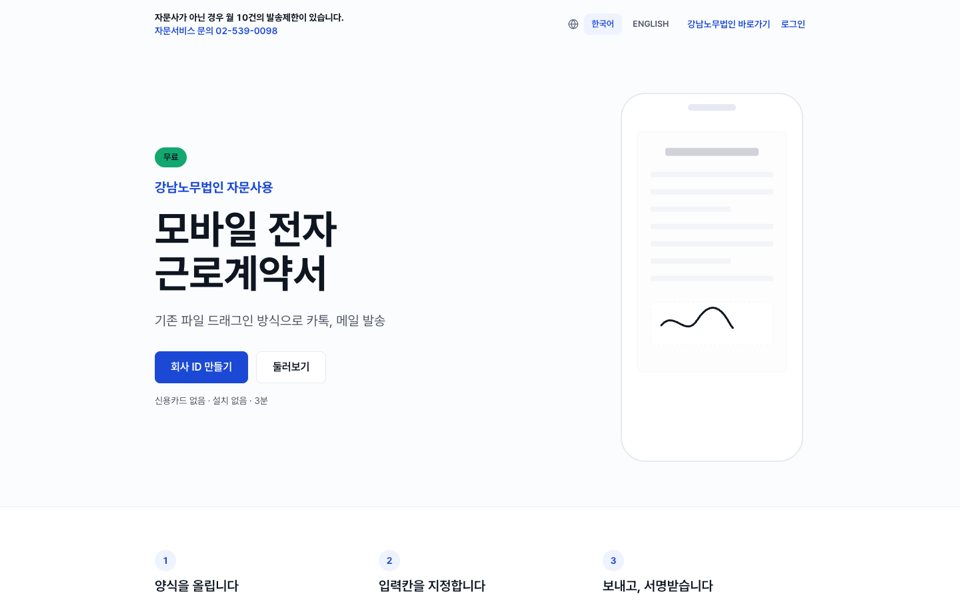
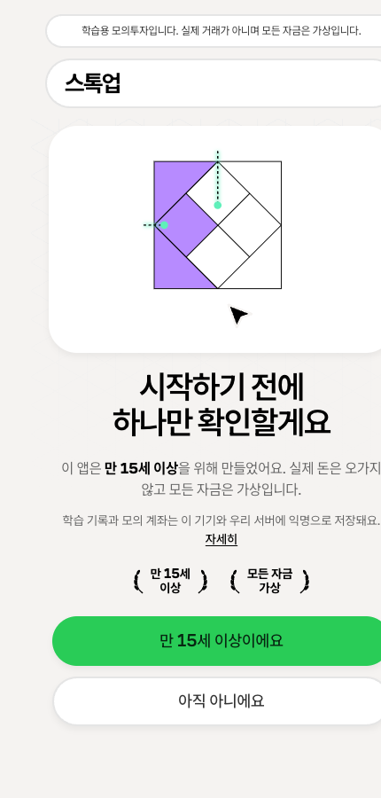
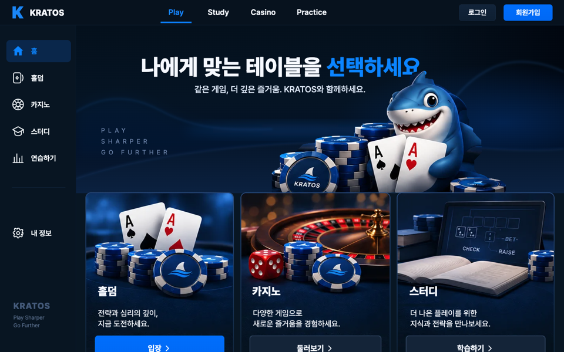
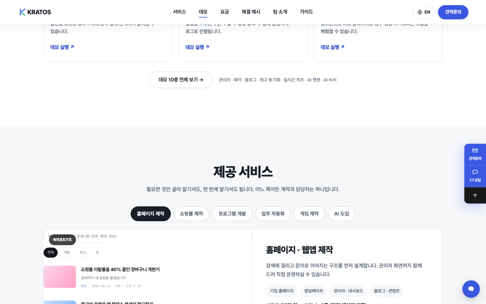
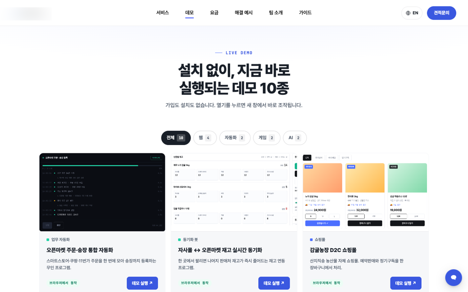
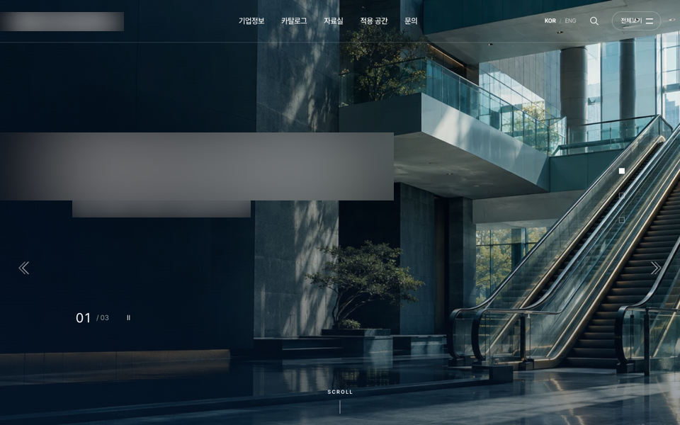
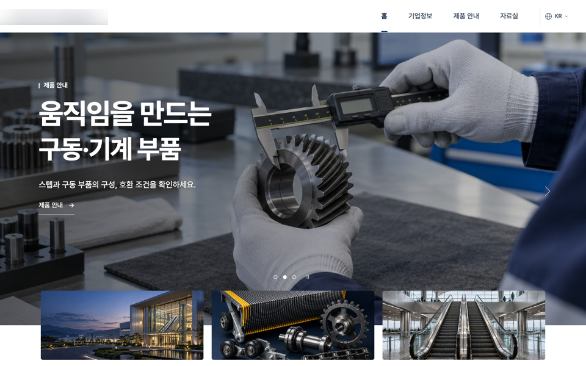
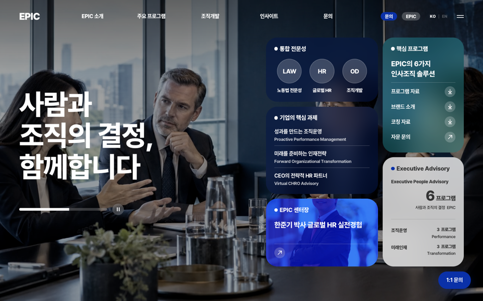
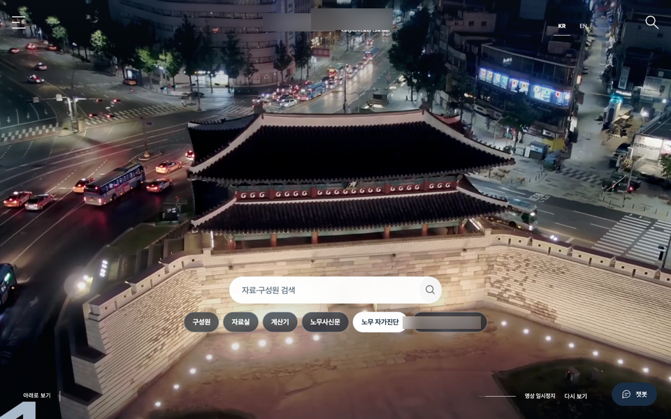
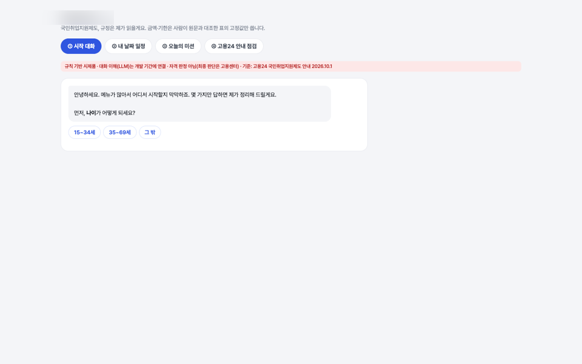

# 이준서 포트폴리오

기획부터 배포까지 혼자 맡아, AI(Claude Code·Codex)를 개발 파트너로 써서 만든 결과물입니다.
**AI가 코드를 쓰고, 저는 기획·설계·판단·검수를 맡습니다.** 명세 → 작업 계획 → 구현 → AI 다관점 검토 → 수정 순서로 반복합니다.

## 대표 프로젝트

| | 서비스 | 링크 |
|---|---|---|
| 1 | **WorkSign** · 모바일 전자근로계약서 | https://worksign.co.kr |
| 2 | **StockUp** · 청소년 주식 학습 모의투자 앱 | https://stockup.kratos1.cloud |
| 3 | **GTO KRATOS** · 포커 전략 학습·게임 웹앱 | https://kratos1.cloud/gtokrato |

---

### 1. WorkSign — 모바일 전자근로계약서
**https://worksign.co.kr**

노무법인 의뢰로 만든 실서비스. 사업주가 계약서를 보내면 근로자가 휴대폰으로 서명하고, 서명된 문서는 위·변조를 막도록 봉인됩니다.

- **만든 방법**: Next.js 15 · Prisma · Postgres(Supabase) · 문서 처리 워커 · Docker · AWS 서울 서버
- **AI 활용**: 고객 지시를 AI 작업 지침서로 정리해 변경 요청마다 근거를 남기고, AI가 구현한 결과를 자동 검사로 검증 — 테스트 329개 통과 · 접근성(WCAG 2.2) 위반 0건 · Lighthouse 100점

### 2. StockUp — 청소년 주식 학습 모의투자 앱
**https://stockup.kratos1.cloud**

만 15세 이상 청소년이 가상 자금으로 투자를 배우는 앱. 실제 시세로 연습하고, 레슨·퀴즈로 개념을 익힙니다.

- **만든 방법**: Next.js 16 · 토스증권 Open API 실시세 · 금융감독원 DART 재무 데이터 · Supabase · AWS 서울 서버
- **AI 활용**: 화면·버튼 단위로 AI가 여러 관점(학습자·보호자·규제)에서 비판 검토 → 확정된 문제만 고치는 루프로 품질 관리 · 학습 영상을 AI 음성과 Remotion으로 자동 생성하는 파이프라인 구축

### 3. GTO KRATOS — 포커 전략 학습·게임 웹앱
**https://kratos1.cloud/gtokrato**

포커 전략(GTO)을 공부하고 바로 실전처럼 연습하는 웹앱. 홀덤 방·Sit & Go, 바카라, 블랙잭을 게임 머니로 즐깁니다.

- **만든 방법**: 외부 라이브러리 없는 Node 서버 · 게임 엔진 · SQLite + Supabase 이중 저장
- **AI 활용**: 게임 규칙·확률 엔진과 실시간 방 서버를 AI와 함께 설계·구현하고, 버전마다 AI 검토로 규칙 오류를 잡아냄

---

## 웹사이트 디자인 시안

링크나 이미지를 누르면 실제 사이트가 열립니다.

### 크라토스 (외주 개발사 홈페이지)
외주 개발사 소개·견적 상담 사이트. 체험형 데모 10종을 함께 운영.

- 홈: https://kratos1.cloud/
- 데모 모음: https://kratos1.cloud/demos

### 케이·에스컬레이터 (제조사 홈페이지 · 시안 3종)
같은 회사를 세 가지 방향(기본·현대형·백과사전형)으로 제안한 시안.

- 기본형: https://kratos1.cloud/escalator/
- 현대형: https://kratos1.cloud/p/ke-hyundai/
- 백과사전형: https://kratos1.cloud/p/ke-hpedia/

### EPIC (인사·조직 컨설팅 · 시안 2종)
컨설팅 회사의 신뢰감을 살린 두 가지 레이아웃 시안.

- 1안: https://kratos1.cloud/p/epic/
- 2안: https://kratos1.cloud/p/epic-jbfg-1009/

### 강남노무법인 K-LABOR
노무법인 홈페이지 리뉴얼. WorkSign과 연결.

- K-LABOR: https://kratos1.cloud/p/klabor-7f3c9a/

### EGATTOC (웰니스 쇼핑몰)
식품·바디케어 웰니스 쇼핑몰.

- EGATTOC: https://cyb3rmaya.github.io/egattoc-wellness/

### 바로시작 (청년 취업지원제도 안내 챗봇 시제품)
질문 몇 개로 받을 수 있는 지원금을 안내하는 챗봇 시제품.

- 바로시작: https://cyb3rmaya.github.io/barosijak-demo/
